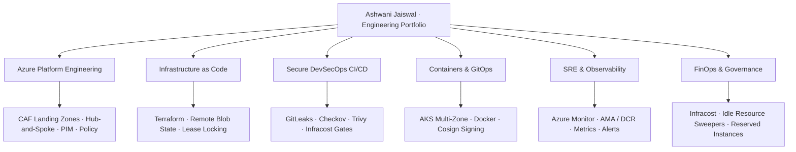

### Azure DevOps Engineer · DevSecOps Engineer · Cloud Infrastructure Specialist

**Secure infrastructure. Repeatable delivery. Observable, resilient systems.**

---

## 👋 About

I am an **Azure DevOps and DevSecOps Engineer** focused on Microsoft Azure, Infrastructure as Code, CI/CD automation, cloud security, and platform reliability. I use this GitHub portfolio to document real-world architectural implementations, security validation gates, operational runbooks, and disaster recovery blueprints.

My professional focus is on making cloud infrastructure **repeatable, reviewable, secure, and easier to operate**—from modular Terraform landing zones and automated Shift-Left security pipelines to containerized Kubernetes workloads, continuous FinOps, and automated observability.

- 📍 Based in India (Open to global remote, hybrid, and enterprise roles)
- 🎯 Core focus: Azure DevOps, DevSecOps, Terraform, Kubernetes (AKS), SRE, and Platform Engineering
- 🧱 Primary competencies: Azure CAF Landing Zones, Hub-and-Spoke networking, Checkov/Trivy/GitLeaks quality gates, automated FinOps cost governance, and high availability
- 🤝 [Connect with me on LinkedIn](https://www.linkedin.com/in/iashwanijaiswal/)

> **Portfolio principle:** A repository should explain how to run it, how to validate it, what risks remain, and what is implemented versus planned. A green badge alone is not proof of production readiness.

---

## 🧭 Portfolio Architecture

---

## 🧰 Technology Stack

 

| Area | Tools and Practices |
|---|---|
| ☁️ **Cloud Platform** | Microsoft Azure, Azure Cloud Adoption Framework (CAF), Virtual Networks, Hub-and-Spoke, ExpressRoute, Azure Firewall Premium, Private Endpoints, Entra ID, PIM |
| 🏗️ **Infrastructure as Code** | Terraform, OpenTofu, Terragrunt, reusable modules, private remote state (Azure Blob Storage with lease locking), plan/apply automation, drift detection |
| 🔄 **CI/CD Pipelines** | Azure DevOps (Pipelines & Repos), GitHub Actions, multi-stage YAML pipelines, approval gates, branch protection policies, `CODEOWNERS` |
| 🔐 **DevSecOps & Security** | Shift-Left security, GitLeaks (secret hygiene), Checkov (IaC posture), Trivy (CVE scans), Syft (SBOM), Cosign (container signing), Azure Policy (CIS Benchmarks) |
| 📦 **Containers & Kubernetes** | Docker, Azure Kubernetes Service (AKS), multi-AZ node pools, Helm, ArgoCD (GitOps), distroless images, Falco runtime monitoring |
| 📊 **Reliability & Observability** | Azure Monitor, Azure Monitor Agent (AMA), Data Collection Rules (DCR), Log Analytics (KQL), Prometheus, Grafana, alerts, incident runbooks, SLI/SLO |
| 💸 **FinOps & Cost Optimization** | Infracost (shift-left PR budgets), automated orphaned disk/IP sweepers, non-prod scheduled hibernation, Reserved Instances (RI) & Savings Plans |
| 🐧 **Systems & Scripting** | Linux, Bash, PowerShell, Python 3.12, Git |

---

## 🏅 Microsoft Certifications Track

- **AZ-400** — Designing and Implementing Microsoft DevOps Solutions
- **AZ-305** — Designing Microsoft Azure Infrastructure Solutions
- **AZ-500** — Microsoft Azure Security Technologies
- **AZ-104** — Microsoft Azure Administrator
- **CKA** — Certified Kubernetes Administrator (Linux Foundation)

---

## 🚀 Featured Projects

### 1. 📊 [Enterprise SRE Observability & Incident Response Platform](https://github.com/iashwanijaiswal/enterprise-sre-observability-platform)
A comprehensive observability and reliability engineering platform integrated with Azure Monitor and Prometheus. Features custom KQL dashboards, Grafana visualization, Data Collection Rules (DCR) for log tuning, automated alert routing to Teams/Slack, and documented incident runbooks with defined SLI/SLO targets.

- [Repository](https://github.com/iashwanijaiswal)
- [Prometheus & Alert Rules](https://github.com/iashwanijaiswal)
- [Incident Response Runbook](https://github.com/iashwanijaiswal)

### 2. 🛡️ [Azure Enterprise DevSecOps Platform](https://github.com/iashwanijaiswal/azure-enterprise-devsecops-platform)
A multi-stage, zero-trust delivery engine built with **Azure Pipelines & GitHub Actions**. Automatically executes pre-commit formatting, GitLeaks secret detection, Checkov IaC security benchmarks, Trivy container CVE scans, Infracost budget estimations, and cryptographic image signing via Cosign.

- [Repository](https://github.com/iashwanijaiswal)
- [CI/CD Workflow Definitions](https://github.com/iashwanijaiswal)
- [Threat Model & Security Policy](https://github.com/iashwanijaiswal)

### 3. ☁️ [Azure Production Cloud Adoption Framework (CAF) Landing Zone](https://github.com/iashwanijaiswal/azure-caf-production-landing-zone)
Enterprise Terraform implementation of the Microsoft Cloud Adoption Framework (CAF). Configures Tenant Root Management Group hierarchies, Platform MGs (Identity, Connectivity, Management), and Workload Landing Zones (Corp, Online, Sandbox) with centralized Azure Firewall Premium inspection and non-overlapping CIDRs.

- [Repository](https://github.com/iashwanijaiswal)
- [Terraform Modular Architecture](https://github.com/iashwanijaiswal)
- [Drift Detection Workflow](https://github.com/iashwanijaiswal)

### 4. 🏢 [Azure Enterprise 3-Tier Zero-Trust Architecture](https://github.com/iashwanijaiswal/azure-enterprise-3-tier-architecture)
A production-ready reference architecture deploying segmented Web, App, and Database tiers across isolated subnets. Integrates Azure Application Gateway with WAF, AKS private clusters, and Azure SQL via Private Endpoints—completely eliminating public IP exposure.

- [Repository](https://github.com/iashwanijaiswal)
- [Network Segmentation Guide](https://github.com/iashwanijaiswal)
- [Validation & Smoke Tests](https://github.com/iashwanijaiswal)

### 5. 💸 [Serverless Azure FinOps & Cloud Waste Eliminator](https://github.com/iashwanijaiswal/azure-finops-waste-eliminator)
An event-driven serverless FinOps automation deployed on Azure Functions. Automatically detects and alerts on orphaned managed disks, unassociated public IPs, and obsolete snapshots, while enforcing business-hours auto-shutdown for non-production environments to slash cloud spend by 30%+.

- [Repository](https://github.com/iashwanijaiswal)
- [Cost Optimization Runbook](https://github.com/iashwanijaiswal)
- [Infracost PR Automation](https://github.com/iashwanijaiswal)

### 6. 🔄 [Azure Terraform Modular CI/CD Engine](https://github.com/iashwanijaiswal/azure-terraform-modular-cicd)
A battle-tested CI/CD framework for managing Terraform at enterprise scale. Implements remote state backend locking using Azure Blob Storage leases, automated plan generation, and scheduled night pipelines for continuous state drift detection (`terraform plan -detailed-exitcode`).

- [Repository](https://github.com/iashwanijaiswal)
- [Pipeline Configuration](https://github.com/iashwanijaiswal)
- [State Locking & Security Spec](https://github.com/iashwanijaiswal)

### 7. 🐳 [Hardened Container & Kubernetes (AKS) GitOps Delivery](https://github.com/iashwanijaiswal/hardened-aks-gitops-delivery)
Container-oriented GitOps delivery using ArgoCD on Azure Kubernetes Service (AKS). Enforces distroless base images, Syft SBOM generation, Falco runtime anomaly detection, and automated canary deployments.

- [Repository](https://github.com/iashwanijaiswal)
- [Container Security Checklist](https://github.com/iashwanijaiswal)
- [GitOps Deployment Manifests](https://github.com/iashwanijaiswal)

---

## 🔐 Engineering Principles

- **Infrastructure as Code:** Keep all infrastructure strictly version-controlled, modular, repeatable, and reviewable through GitOps.
- **Shift Security Left:** Enforce formatting, linting, secrets detection, and vulnerability scanning on every pull request before deployment.
- **Protect Credentials & Identity:** Zero hardcoded secrets; mandate Privileged Identity Management (PIM) with Just-In-Time (JIT) access and Managed Identities for all cloud workloads.
- **Least Privilege & Micro-Segmentation:** Isolate network blast radiuses using Hub-and-Spoke topologies, NSGs, and Private Link.
- **Safer Change Management:** Always generate speculative execution plans, validate Infracost budget impacts, and mandate peer review (`CODEOWNERS`) for production updates.
- **Operational Readiness & Resilience:** Every service must ship with health probes, alerts, centralized logs, disaster recovery validation, and incident runbooks.
- **Evidence Over Claims:** Quantify reliability through validated metrics (99.99% SLA, RTO < 30m, RPO < 15m) and transparent architecture decision records.

---

## 🎯 Current Portfolio Priorities

- 📊 Developing and publishing an end-to-end **SRE Observability Lab** with Prometheus, Grafana, and automated Azure alert escalation.
- 🛡️ Expanding automated DevSecOps pipelines with SBOM generation (Syft) and cryptographic container signing (Cosign).
- ☁️ Hardening enterprise Terraform modules with strict semantic versioning and automated state drift detection.
- 📋 Documenting comprehensive architecture decision records (ADRs), threat models, and reproducible validation guides for every featured repository.

---

## 🤝 Connect

I am actively open to discussions and opportunities around **Azure DevOps, DevSecOps, Cloud Architecture, SRE, and Platform Engineering**.

 

